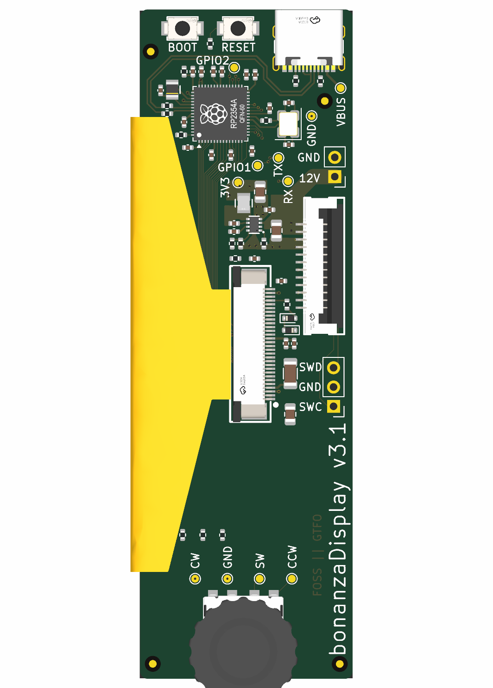

# bonanzaDisplay v3.1

bonanzaDisplay is an open hardware OLED display and rotary-encoder controller
for **bitaxeBonanza-1004x**. An onboard Raspberry Pi RP2354A drives the display,
reads the encoder and its push button, and connects to the host ESP32 through
a single flat-flex cable carrying power, communication signals, and debug access.

This repository contains the **v3.1 KiCad hardware design**. Firmware, the
display UI, and the host communication protocol are not included here.

*Component-side render; the OLED panel faces the other side of the board.*

## Hardware overview

| Function | Implementation |
| --- | --- |
| Controller | Raspberry Pi RP2354A |
| Display | 3.12-inch, 256 × 64 OLED module using an SSD1322 controller |
| Display interface | 8-bit 8080 parallel bus |
| User input | Rotary encoder with push button (SW3) |
| Host connection | 12-pin, 1.0 mm pitch FFC connector (J5) |
| Host signals | TX/RX, two GPIO signals, SWDIO, and SWCLK |
| Power input | Nominal 12 V through J5 or the J2 bench-power pads |
| Logic supply | 3.3 V from a TPS62933 buck regulator |
| Development | USB-C (J6), SWD pads (J15), BOOT and RESET buttons |
| PCB | Six layers, with filled and copper-capped through vias |

The RP2354A handles the display and local controls, allowing the host to send
application data rather than drive the OLED bus directly. The actual UI and
division of work between the two processors depend on firmware.

## Connecting the board

### Host cable and J5 pinout

The intended connection is display J5 to **J5 on bitaxeBonanza-1004x**:

- Display connector: **JUSHUO AFA01-S12FCA-00**, LCSC C262757, bottom contact.
- Host connector: **TE 1-1735042-2**, LCSC C3169702.
- Cable: **12 conductors, 1.0 mm pitch, same-side exposed contacts**, with
  nominal 0.3 mm mating thickness. An example is SHOUHAN FFC-1.0-12P-50mm,
  **LCSC C6936374**.

For this connector pair, the standard same-side cable connects display pin
`n` to host pin `13 − n`. This numbering reversal is intentional; a custom
crossover cable is not required. Verify pin 1 and contact orientation before
applying power, since an incorrect connection can put 12 V on debug signals.

| Display J5 pin | Host J5 pin | Display net | RP2354A connection |
| --- | --- | --- | --- |
| 1 | 12 | 12V | Power input |
| 2 | 11 | 12V | Power input |
| 3 | 10 | GND | Ground |
| 4 | 9 | GND | Ground |
| 5 | 8 | DISP_GPIO1 | GPIO22 |
| 6 | 7 | DISP_GPIO2 | GPIO23 |
| 7 | 6 | GND | Ground |
| 8 | 5 | DISP_TX | GPIO21 |
| 9 | 4 | DISP_RX | GPIO20 |
| 10 | 3 | GND | Ground |
| 11 | 2 | SWD | SWDIO |
| 12 | 1 | SWCLK | SWCLK |

TX/RX above are the schematic net names. Firmware must implement the serial
interface on these exact GPIOs; the names do not establish a hardware UART
pin-mux configuration.

At the display's bottom-contact connector, the exposed cable contacts face
the PCB. At the TE host connector, they face the even-numbered solder-tail
side. Connector verification is recorded in
[issue #16](https://github.com/bitaxeorg/bonanzaDisplay/issues/16).

### OLED module and J1

J1 is a **JUSHUO AFC07-S30ECA-00** (LCSC C262645), a 30-contact, 0.5 mm pitch,
top-contact connector for nominal 0.3 mm flex. The OLED ribbon's physical
fit and contact orientation have been checked against the intended module.

The [EA W256064-XALG datasheet](https://www.lcd-module.de/fileadmin/html-seiten/eng/pdf/grafik/W256064-XALG.pdf)
is the reference for the module interface and electrical requirements.
Similar modules are sold under several manufacturer part numbers; check the
pinout, voltage requirements, and ribbon orientation of the exact module
being purchased rather than relying on screen size or controller name alone.

**Keep the project's custom J1 footprint.** Its pad numbers follow the OLED
module's numbering: KiCad pad `n` corresponds to connector drawing circuit
`31 − n`. Replacing it with a generic footprint without checking this mapping
can reverse the interface. Pads 31 and 32 are the grounded mounting tabs.

### Power

The host normally supplies 12 V through J5. For standalone development,
supply **J2 pin 1 with 12 V and J2 pin 2 with GND**. J2 is an optional header
location; the header is excluded from the current PCBA assembly selection.
**USB does not power the board.**

U4 converts 12 V to 3.3 V for the MCU and OLED logic. The OLED's VCI and
VDDIO inputs both use 3.3 V; separate 3.0 V and 2.8 V regulators are not
needed in this revision. The RP2354A's internal regulator supplies its core
through L1.

The OLED panel supply, VCC, connects directly to 12 V. There is no MCU-controlled
load switch or independent VCC sequencing. This is an accepted limitation of
v3.1, tracked in [issue #7](https://github.com/bitaxeorg/bonanzaDisplay/issues/7).
Firmware delays cannot switch this hardwired rail.

## Firmware interfaces

### Display

The hardware straps select **8-bit 8080 mode** (BS1 high, BS0 low).

| Function | RP2354A GPIO | J1 pin |
| --- | --- | --- |
| D0–D7 | GPIO0–GPIO7, respectively | 13 down to 6 |
| Reset, active low | GPIO8 | 20 |
| Chip select, active low | GPIO9 | 19 |
| Data/command | GPIO10 | 18 |
| Write strobe, active low | GPIO11 | 15 |
| Read strobe, active low | GPIO12 | 14 |

Use 8080 bus timing, and keep RD inactive for write-only operation. The
reference module's example SPI transport cannot be copied unchanged.

The OLED's VDD pin has a bypass capacitor but no external supply, so
initialization must enable the SSD1322's internal VDD regulator. Initialization
must also match the fitted external VSL diode/resistor network and the exact
module's reset and startup timing. See the reference module datasheet above.

### Encoder

| SW3 contact / net | RP2354A GPIO | Pull-up to 3.3 V |
| --- | --- | --- |
| B / SW_CW | GPIO13 | R41, 4.7 kΩ |
| S / SW_SW (push button) | GPIO14 | R42, 4.7 kΩ |
| A / SW_CCW | GPIO15 | R43, 4.7 kΩ |

The common contact is grounded. External 4.7 kΩ pull-ups provide approximately
0.70 mA through each closed contact, exceeding the selected HanElectricity
encoder's 0.5 mA minimum per phase. The MCU's internal pull-ups alone do not
meet that contact-current specification. R41–R43 use UNI-ROYAL
0402WGF4701TCE / LCSC C25900, a 0402, ±1% resistor listed as a JLCPCB Basic part
when selected. See the [encoder datasheet, page 2](https://datasheet.lcsc.com/datasheet/pdf/48f6c88fa6dacc08326345335965b3eb.pdf).

Configure the GPIOs as inputs with internal pull-downs disabled; external
resistors provide the pull-ups. Implement quadrature decoding and switch
debounce, and confirm rotation direction on the assembled board. The CW/CCW
net labels alone do not determine the decoder's sign.

## Programming and development

SW1 is **RESET** and SW2 is **BOOT**. The BOOT button connects to the QSPI
chip-select signal through R40, a 1 kΩ series resistor.

For SWD, use the host connector or the optional J15 header pads:

| J15 pin | Signal |
| --- | --- |
| 1 | SWCLK |
| 2 | GND |
| 3 | SWDIO |

Use a debugger compatible with 3.3 V logic and power the board externally.
J15 does not provide a target-voltage reference pin, and its header is excluded
from the current PCBA assembly selection.

The intended field-update path is the host ESP32 programming the RP2354A
through J5's SWD signals. ESP32 SWD support and the complete field-update
workflow still require firmware implementation and validation.

### Development-only USB port

J6 provides USB for development with external 12 V power. This revision
intentionally accepts the following limitations:

- **No VBUS sensing.** VBUS connects only to J6 and test point TP64. The MCU
  cannot detect when a host or hub removes VBUS, so its D+ attachment pull-up
  can remain enabled while the board stays powered. This does not meet the
  USB requirement to remove the attachment pull-up when VBUS is absent and
  can source current into an unpowered host's data input. Disconnect USB
  before shutting down the host/hub or disabling its port power while the
  board remains on. Normal suspend with VBUS present is a different condition.
- **No external USB ESD array.** The port relies on the MCU's internal
  protection and has not been validated for exposed production use or
  system-level ESD immunity. Use normal ESD precautions during development.

These choices are recorded in
[issue #14](https://github.com/bitaxeorg/bonanzaDisplay/issues/14); they are not
a claim of full USB compliance. Revisit them if USB becomes a user-facing port.

A future production variant could omit J6 and USB-only resistors R2, R4,
R37, and R38. **The current design still fits these parts**; no USB DNP
assembly variant has been implemented.

## Working with the design

Open [bonanzaDisplay.kicad_pro](bonanzaDisplay.kicad_pro) in **KiCad 10**.
Keep the repository's library tables, custom libraries, and 3D models together;
the library tables use project-relative paths.

| Path | Contents |
| --- | --- |
| [bonanzaDisplay.kicad_sch](bonanzaDisplay.kicad_sch) | Schematic |
| [bonanzaDisplay.kicad_pcb](bonanzaDisplay.kicad_pcb) | Six-layer PCB layout |
| [bonanzaDisplay.kicad_dru](bonanzaDisplay.kicad_dru) | Custom fabrication rules |
| [bonanzaDisplay.kicad_sym](bonanzaDisplay.kicad_sym) | Project symbol library |
| [bonanzaDisplay.pretty/](bonanzaDisplay.pretty/) | Project footprints |
| [3dshapes/](3dshapes/) | Component and module models |
| [fabrication-toolkit-options.json](fabrication-toolkit-options.json) | Saved Fabrication Toolkit export options |
| [docs/manufacturing.md](docs/manufacturing.md) | Fabrication, via filling, stencil, and assembly requirements |

After schematic changes, update the PCB, refill zones, and run ERC and DRC
including schematic/PCB parity before generating new manufacturing outputs.
Preserve the intentional connector numbering and review placement offsets
when replacing footprints or changing export tools.

## Manufacturing and project status

The board targets JLCPCB's standard **six-layer, 1 oz outer-copper process
with a routed outline**. It requires **epoxy-filled and copper-capped vias
(POFV)**, including vias in solder pads. Tenting alone is insufficient.
The design was reviewed against JLCPCB's no-extra-cost six-layer options on
2026-10-14; confirm the actual quote and process selections when ordering.

Read the [manufacturing guide](docs/manufacturing.md) before generating or
uploading Gerbers, a BOM, or a component placement file. The OLED module and
host FFC cable are separate assembly items, not parts installed by the board
assembly BOM.

At hardware commit [`0fab1ca`](https://github.com/bitaxeorg/bonanzaDisplay/commit/0fab1cac237adbfad9c7c31abaaa868e837f4df0),
KiCad 10.0.6 checks passed with no ERC findings, DRC violations, unconnected
items, or schematic/PCB parity findings. These checks do not establish
assembled-board operation or approve a production order. Remaining work includes:

- Resolving the remaining source BOM metadata discrepancies and checking
  supplier part matches and placement corrections
  ([#13](https://github.com/bitaxeorg/bonanzaDisplay/issues/13)).
- Confirming filled/capped vias and the supplier's final stencil/CAM treatment
  ([#12](https://github.com/bitaxeorg/bonanzaDisplay/issues/12)).
- Reviewing the final assembly preview and validating firmware and assembled
  hardware, including display startup, encoder input, oscillator operation,
  BOOT, USB, and the intended host update workflow
  ([#17](https://github.com/bitaxeorg/bonanzaDisplay/issues/17)).

Use the [issue tracker](https://github.com/bitaxeorg/bonanzaDisplay/issues)
for review findings, accepted limitations, and their resolution. When reporting
a problem, include the board revision, hardware/firmware commits, exact OLED
module, and steps to reproduce it.

## License

The hardware design is licensed under the
**CERN Open Hardware Licence v2 — Strongly Reciprocal (CERN-OHL-S-2.0)**.
See [LICENSE](LICENSE) for the full terms.
